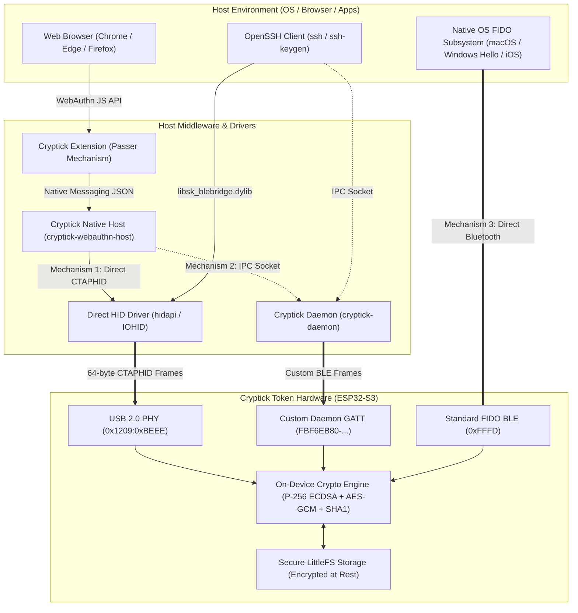

# Cryptick Token Architecture & Security Specifications

This document defines the transport architecture, GATT isolation guarantees, and cryptographic boundary of the Cryptick Token Daemon, host tools, and browser extension.

---

## 1. Dual-GATT Radio Architecture & Native FIDO Isolation

The Cryptick Token hardware (ESP32-S3) exposes distinct Bluetooth Low Energy (BLE) GATT services to guarantee that host middleware **never** obstructs or collides with native OS/browser FIDO BLE implementations.

### Service UUID Map

| Service Name | Service UUID | Characteristic UUIDs | Handled By | Purpose |
|--------------|--------------|----------------------|------------|---------|
| **Standard FIDO BLE** | `0000FFFD-0000-1000-8000-00805F9B34FB` | Control Point (`0xF1D0FFF1`), Status (`0xF1D0FFF2`), Len (`0xF1D0FFF3`), Rev (`0xF1D0FFF4`) | Native Host OS (Windows Hello, macOS TouchID BLE, Android, iOS) | Direct native browser/OS FIDO2/WebAuthn pairing. **Never touched by the daemon.** |
| **Daemon Bridge GATT** | `FBF6EB80-7F39-41B1-A191-9527CC42F8BE` | Control Point (`FBF6EB81`), Status (`FBF6EB82`), Len (`FBF6EB83`), Version (`FBF6EB84`) | `cryptick-daemon` (`crates/transport-ble`) | Bridge transport relaying CTAP frames to local virtual HID / domain sockets. |
| **PIV Smart Card GATT** | `FBF6EB90-7F39-41B1-A191-9527CC42F8BE` | Control Point (`FBF6EB91`), Status (`FBF6EB92`), Len (`FBF6EB93`), ATR (`FBF6EB94`) | `cryptick-daemon` (CCID reader) | ISO 7816 APDUs for PIV smart card certificates and PKI authentication. |

### Native FIDO Zero-Interference Guarantee
1. **Dedicated Service UUID**: In `crates/transport-ble/src/transport.rs`, the daemon connects strictly to `DAEMON_CONTROL_POINT` (`FBF6EB81-...`) and `DAEMON_STATUS` (`FBF6EB82-...`).
2. **Standard 0xFFFD Remains Unmolested**: Because the daemon leaves service `0xFFFD` untouched, upcoming OS-level FIDO BLE stacks (macOS Native WebAuthn BLE, Windows WebAuthn Bluetooth, Linux bluez-fido) can discover, pair, and bond to the standard FIDO service without conflicts, GATT attribute race conditions, or dropped notifications.
3. **Firmware Separation**: In the firmware (`core/ble_fido/`), `ble_gatt_esp32.cpp` handles `0xFFFD` on a dedicated context while `ble_daemon_gatt_esp32.cpp` handles `FBF6EB80` on an isolated context.

---

## 2. On-Device Hardware TOTP & Zero-Trust Boundary

### Zero-Trust Passer Principle
Neither the browser extension (`extensions/cryptick-webauthn`) nor the local native messaging host (`crates/webauthn-host`) perform HMAC-SHA1 calculations or store TOTP secret seeds:
- **Seed Location**: TOTP base32/binary secrets reside exclusively in the ESP32-S3 hardware flash (LittleFS), encrypted at rest via hardware-backed AES-GCM.
- **Computation**: The RFC 6238 HMAC-SHA1 step calculation is computed strictly on the ESP32-S3 CPU using on-chip hardware timer/RTC.
- **Host Role**: The host and extension act purely as transparent transport conduits. Only the resulting 6-digit one-time code and remaining validity window are returned.

### CTAPHID Framing (`CTAPHID_CRYPTICK_OATH = 0xE3`)
The token accepts YKOATH-compatible APDU-lite messages framed over CTAPHID vendor command `0xE3` (`TYPE_INIT | 0x63`):

```text
Host -> Token:
CLA (0x00) | INS | P1 (0x00) | P2 (0x00) | Lc | TLVs...

Token -> Host:
[Response TLVs...] | SW1 | SW2  (0x90 0x00 = Success)
```

#### Supported Instructions
1. **`INS 0xA1` (LIST)**:
   - Does not require user verification (UV).
   - Returns array of account names encoded in Tag `0x71` (`TAG_NAME`).
2. **`INS 0xA2` (CALCULATE)**:
   - Request carries Tag `0x71` (name) + Tag `0x74` (8-byte big-endian time-step counter: `now_utc / 30`).
   - Gated by User Verification (UV): requires physical touch / fingerprint sensor interaction if biometric templates are enrolled.
   - Token computes code on-chip and answers with Tag `0x75` (`TAG_RESPONSE`) carrying the 4-byte big-endian integer code.
3. **`INS 0x04` (SET_TIME)**:
   - Synchronizes device RTC with host UTC timestamp.

---

## 3. Independent Multi-Transport Mechanisms

Cryptick Token does **not** rely on a degraded "fallback" chain. Instead, it provides **four coequal, dedicated access mechanisms**, each optimized for a distinct host environment and physical interface:



### Mechanism Characteristics Matrix

| Mechanism | Channel | Service / Interface | Handled By | Daemon Required? | Ideal Use Case |
|---|---|---|---|---|---|
| **Mechanism 1: Direct USB CTAPHID** | Wired USB-C | `0x1209:0xBEEE` (Usage Page `0xF1D0`) | Host OS HID driver via `UsbClient` | **No** (Direct Hardware Access) | Desktop workstation, maximum speed, zero radio latency |
| **Mechanism 2: Host-Assisted BLE Bridge** | Wireless BLE | Custom GATT `FBF6EB80-7F39-41B1-...` | `cryptick-daemon` -> Unix Socket | **Yes** (Runs as background daemon) | Wireless laptop usage, browser passkeys, OpenSSH |
| **Mechanism 3: Standard Native FIDO BLE** | Wireless BLE | Standard GATT `0000FFFD-...` | OS Bluetooth Stack (Windows Hello, macOS, iOS) | **No** (Direct OS Pairing) | Mobile devices, unmanaged OS environments, direct browser WebAuthn |
| **Mechanism 4: Hardware TOTP Engine** | USB / BLE | `CTAPHID_CRYPTICK_OATH` (`0xE3`) | On-Chip Crypto Engine (LittleFS) | **No** (Extension is pure passer) | Air-gapped 2FA codes without storing seeds on PC/Browser |

### Host Channel Resolution
When an application (such as the browser extension or OpenSSH middleware) requests an operation:
1. **Wired Channel**: If the token is physically plugged in via USB, the host connects directly to the USB HID interface (`UsbClient`) for sub-millisecond execution.
2. **Wireless Channel**: If the token is untethered, the host connects via the daemon Unix socket (`DaemonClient`) to transmit across the dedicated Custom GATT service (`FBF6EB80`).
3. **Platform Passkey Delegation**: If the user explicitly disables the Cryptick interception toggle in the extension popup, requests pass directly to the platform's native passkey manager (e.g. iCloud Keychain, Windows Hello), giving the user full control over their credential ecosystem.

