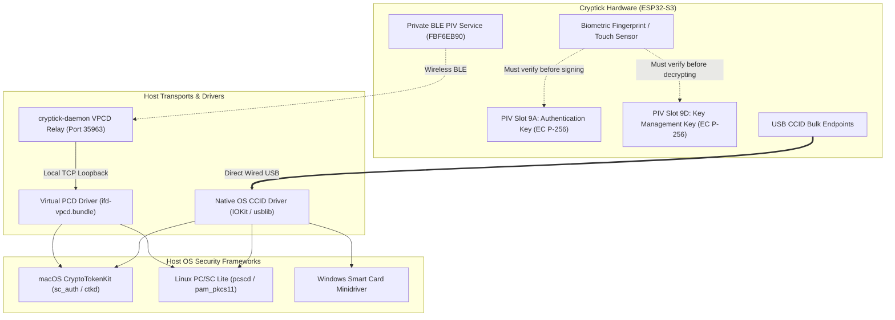

# Computer Login & Smart Card Authentication Guide

This document describes how to use the **Cryptick Token** for operating system computer login, lock-screen unlocking, and `sudo` privilege escalation on **macOS**, **Linux**, and **Windows**.

It details both **wired USB CCID** and **wireless Bluetooth Low Energy (BLE)** smart card operation, featuring Cryptick's automated login wizard: `cryptick login setup`.

---

## 1. Overview & Authentication Architecture

Cryptick implements the **NIST SP 800-73-5 PIV (Personal Identity Verification)** card specification. Operating systems identify Cryptick as an enterprise-grade hardware smart card:



### Transport Modes
1. **Wired USB Mode**:
   - Cryptick enumerates as a USB Composite device: CTAPHID (`0xF1D0`) + CCID (`0x0B`).
   - The OS native CCID class driver binds directly to the device.
   - Zero host daemons or background software required.
2. **Wireless BLE Mode (World First)**:
   - Cryptick carries ISO 7816 APDUs over its dedicated PIV GATT service (`FBF6EB90-7F39-41B1-...`).
   - `cryptick-daemon` receives BLE APDUs and feeds them into the macOS/Linux smart card subsystem via a lightweight Virtual PCD driver (`ifd-vpcd.bundle`).
   - Enables full wireless login and lock-screen unlock while your token stays on your keychain or desk.

---

## 2. Automated Computer Login Wizard (`cryptick login`)

Cryptick provides an automated, guided command-line wizard to provision certificates and pair your operating system account in seconds:

```bash
cryptick login [setup | status | remove]
```

### 2.1 One-Step Setup (`cryptick login setup`)

Run the automated wizard in your terminal:

```bash
cryptick login setup
```

#### What the Wizard Automates:
1. **Subsystem Discovery**: Detects whether your host is macOS or Linux, and verifies whether the Virtual PCD driver (`ifd-vpcd.bundle`) and background daemon are installed.
2. **On-Token Key Generation**: Invokes `cryptick-piv` to instruct the hardware token to generate a fresh EC P-256 keypair inside **Slot 9A (PIV Authentication)**.
3. **X.509 Certificate Issuance**: Constructs a self-signed X.509 v3 certificate matching your logged-in username (e.g. `CN=aurelius (Cryptick Login)`) with:
   - Key Usage: `Digital Signature` (`0x80`)
   - Extended Key Usage: `Smart Card Logon` (`1.3.6.1.4.1.311.20.2.2`) and `Client Authentication` (`1.3.6.1.5.5.7.3.2`).
4. **SP 800-73-5 Container Injection**: Encodes the certificate into PIV container `Tag 0x53` and writes it to the token using chained `PUT DATA` APDUs.
5. **OS Account Pairing**:
   - **macOS**: Discovers the certificate hash via `sc_auth identities` and executes `sc_auth pair -u "$USER" -h "$HASH"`.
   - **Linux**: Verifies `pcscd` and emits the PAM configuration block.

#### Advanced Setup Options
```bash
# Provision with custom PIN (default PIN is 123456)
cryptick login setup --pin 654321

# Provision both Slot 9A (Authentication) and Slot 9D (Key Management)
cryptick login setup --all

# Run simulated dry-run without writing to physical hardware
cryptick login setup --dry-run
```

---

### 2.2 Inspecting Login Status (`cryptick login status`)

Check the health of your smart card subsystem, driver installation, and paired certificates:

```bash
$ cryptick login status

❖ Cryptick Token Unified Manager (v0.1.0)
------------------------------------------------
❖ Cryptick Computer Login Wizard

Checking Computer Login & Smart Card Status...

  Platform          : macOS (CryptoTokenKit & PC/SC)
  Virtual Reader    : Installed (/usr/local/libexec/SmartCardServices/drivers/ifd-vpcd.bundle)

  Paired SmartCard Identities for aurelius:
  Hash: 3B564922614AFE0917FB12449A9E62EE36863CC9

  Detected SmartCard Tokens on Host:
  Cryptick Token PIV (Slot 9A - aurelius)
```

---

### 2.3 Unpairing / Removing Login (`cryptick login remove`)

To unpair your token and restore standard password-only authentication:

```bash
cryptick login remove
```

On macOS, this executes `sc_auth unpair -u "$USER"`.

---

## 3. macOS Smart Card Login Guide

macOS includes native enterprise smart card support through the **CryptoTokenKit (CTK)** framework.

### 3.1 Unlocking Your Mac
Once paired via `cryptick login setup`:
1. **Lock Screen Unlock**:
   - Lock your screen anytime with `Cmd + Ctrl + Q`.
   - Wake the display.
   - The lock screen displays your user icon with a smart card symbol.
   - Touch the capacitive fingerprint sensor or tap the knob on your Cryptick Token.
   - The Mac unlocks instantly without typing your password!
2. **Cold Boot & Login Window**:
   - At the macOS login screen, smart card authentication is immediately active.
   - Insert the token via USB or wake BLE advertising (click knob).
   - Enter your card PIN or tap fingerprint to sign in.

### 3.2 Terminal Sudo Authorization
You can authorize `sudo` commands using your Cryptick Token instead of typing your password.

Edit `/etc/pam.d/sudo`:
```bash
sudo nano /etc/pam.d/sudo
```

Add `pam_smartcard.so` at the top:
```pam
# sudo: auth account password session
auth       sufficient     pam_smartcard.so
auth       required       pam_opendirectory.so
account    required       pam_permit.so
password   required       pam_deny.so
session    required       pam_permit.so
```

Now, running `sudo ls` prompts:
```text
SmartCard PIN: [or touch fingerprint on Cryptick Token]
```

### 3.3 Wireless BLE Smart Card Driver Setup
To enable wireless smart card login across Bluetooth, the Virtual Smart Card Driver must be installed once:

```bash
sudo ./scripts/install_vpcd.sh
```

This compiles `ifd-vpcd.bundle`, installs it to `/usr/local/libexec/SmartCardServices/drivers/`, registers the channel in `/etc/reader.conf`, and restarts `com.apple.ifdreader`.

---

## 4. Linux PAM Smart Card & U2F Login Guide

On Linux, smart card login is handled through **PC/SC Lite (`pcscd`)** and **PAM (`pam_pkcs11` or `pam_u2f`)**.

### 4.1 Prerequisites & udev Rules
Install the required packages:
```bash
sudo apt update
sudo apt install pcscd libpam-pkcs11 libpam-u2f
```

Install Cryptick's hardware udev rules:
```bash
sudo cp packaging/udev/70-cryptick.rules /etc/udev/rules.d/
sudo udevadm control --reload-rules && sudo udevadm trigger
```

### 4.2 Configuring PAM for Lock Screen & Sudo
To authenticate desktop login (GDM / LightDM / SDDM) and `sudo` with Cryptick:

Edit `/etc/pam.d/common-auth`:
```pam
# Enable Cryptick PKCS#11 authentication with password fallback
auth    [success=2 default=ignore]    pam_pkcs11.so
auth    [success=1 default=ignore]    pam_unix.so nullok_secure try_first_pass
auth    requisite                     pam_deny.so
auth    required                      pam_permit.so
```

---

## 5. Security & Emergency Recovery Policy

> [!IMPORTANT]
> **Emergency Recovery**: Never lock yourself out of your system. Always keep a secondary administrator account with a long password or store an emergency recovery key in a secure vault before enforcing mandatory smart card policies.

### PIN Lockout Counter
Cryptick enforces strict brute-force protection:
- The default card PIN is `123456`. You can change it using `cryptick-piv` or standard PIV tools.
- After **3 consecutive failed PIN attempts**, the PIV applet locks.
- Unlocking requires physical device re-authorization or resetting the applet through the on-token display menu.

### Loss or Depleted Battery
- If the token battery is depleted, plug the token directly into any USB-C port for instantaneous wired CCID operation.
- If the token is lost or unavailable, macOS and Linux automatically present a "Password..." link or fallback prompt allowing standard password login.
