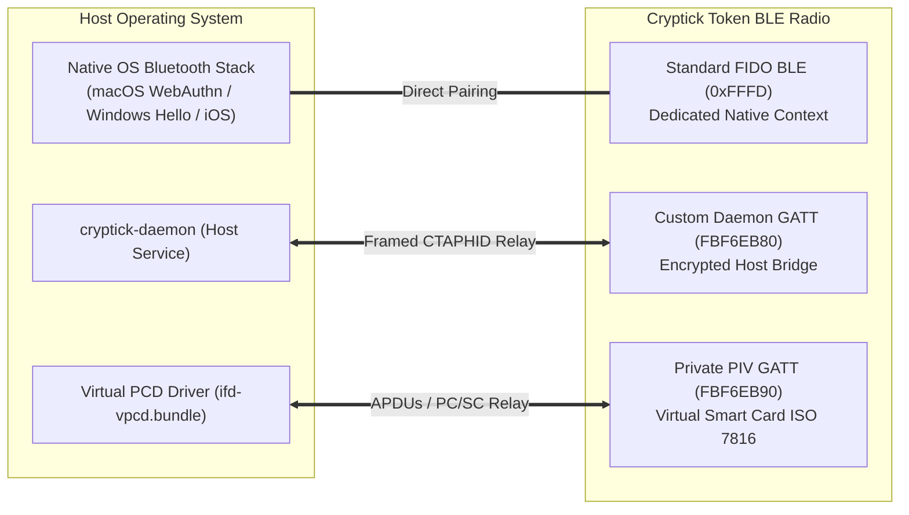

# Cryptick Token: Hardware Specifications & Comparative Architecture

This document provides a comprehensive technical overview of the **Cryptick Token** architecture, hardware specifications, protocol implementations, and comparative analysis against conventional closed-source and headless security keys.

---

## 1. Executive Summary

While legacy security keys have established baseline protocols for hardware authentication, their closed-source architecture, lack of wireless desktop bridging, headless "blind touch" operation, and rigid storage limits impose severe constraints on modern security engineers and mobile professionals.

**Cryptick Token** delivers full feature compliance with open security standards (FIDO2 / WebAuthn Level 3, CTAP2.1, NIST SP 800-73-5 PIV Smart Card, OATH-TOTP, OpenSSH FIDO SK) while delivering four paradigm-shifting advantages:
1. **Wireless BLE Dual-GATT Architecture**: Full wireless WebAuthn, OpenSSH, and PIV smart card login on desktop workstations and laptops.
2. **On-Device Full-Color Display**: True **"What You See Is What You Sign" (WYSIWYS)** transaction, origin, and account verification on-chip.
3. **Zero-Trust Encrypted Flash Enclave**: Supports hundreds of hardware-isolated TOTP seeds with on-chip RTC calculation and biometric gating.
4. **100% Open-Source Hardware, Firmware, and Host Middleware**: Eliminates vendor lock-in, unpatchable black-box silicon vulnerabilities, and unverified backdoors.

---

## 2. Comprehensive Comparison Matrix

| Feature / Capability | Cryptick Token | Conventional Headless Keys | Conventional Biometric Keys |
|---|---|---|---|
| **Hardware License** | **100% Open-Source Hardware & Schematics** | Proprietary Closed Hardware | Proprietary Closed Hardware |
| **Firmware License** | **100% Open-Source (FreeRTOS / C++ / Rust)** | Proprietary Closed Binary | Proprietary Closed Binary |
| **Firmware Upgrades** | **Yes (Secure Boot v2 signed updates)** | **No** (Firmware locked in ROM) | **No** (Firmware locked in ROM) |
| **Physical Display** | **128x64 OLED / Color Display** | **None** (Blind Touch LED) | **None** (Blind Touch LED) |
| **Transaction Verification** | **WYSIWYS**: Shows Origin, User Handle, Action | **None**: Tap blind contact | **None**: Scan blind fingerprint |
| **User Verification (UV)** | **Capacitive Fingerprint Sensor + PIN** | PIN Only | Capacitive Fingerprint Sensor + PIN |
| **Wireless Connectivity** | **Dual-GATT Bluetooth Low Energy (BLE)** | NFC Only (No Desktop Wireless) | **None** (Wired USB Only) |
| **Desktop Wireless PIV** | **Yes** (via `ifd-vpcd` Virtual Smart Card) | **No** (Requires physical USB insertion) | **No** (PIV unsupported) |
| **Desktop Wireless SSH** | **Yes** (via `libsk_blebridge` Daemon Client) | **No** (Requires physical USB insertion) | **No** (Requires physical USB insertion) |
| **FIDO2 / WebAuthn Level** | **WebAuthn Level 3 (CTAP 2.0 & 2.1)** | WebAuthn Level 2/3 (CTAP 2.1) | WebAuthn Level 2 (CTAP 2.0) |
| **Resident Credentials** | **Yes** (Stored encrypted in LittleFS) | **Yes** (Limited credential slots) | **Yes** (Limited credential slots) |
| **CTAP2 Extensions** | `hmac-secret`, `credProtect`, `largeBlob` | `hmac-secret`, `credProtect`, `largeBlob` | Limited |
| **PIV Smart Card (SP 800-73)** | **Yes** (Slots 9A, 9D, 9C, 9E, EC P-256) | **Yes** (RSA & EC P-256/P-384) | **No** (PIV unsupported) |
| **macOS / Linux Computer Login**| **Automated (`cryptick login setup`)** | Manual configuration required | Unsupported |
| **Hardware OATH-TOTP** | **Extensive (Hundreds in LittleFS)** | **Hard Limit (e.g. 32 accounts)** | **No** (OATH unsupported) |
| **TOTP Display on Token** | **Yes (View codes on token screen)** | **No** (Requires host app to view codes) | **No** (No TOTP) |
| **TOTP Seed Exposure** | **Zero-Trust**: Seeds never leave hardware | Seeds sent to host app over CCID/HID | N/A |
| **Auditability** | Transparent peer-reviewable code | Black-box silicon (Proprietary microcontrollers) | Black-box silicon |

---

## 3. Cryptick's Key Architectural Advantages

### Advantage 1: Wireless BLE Dual-GATT Architecture

#### Why Legacy Keys Abandoned Wireless Desktop Bridging
Early attempts at wireless security keys suffered from significant architectural flaws:
1. **Native OS BLE Stack Hostility**: Operating systems frequently broke generic Bluetooth FIDO implementations, resulting in pairing hangs and dropped transactions.
2. **Standard Service Collision**: Running proprietary host management commands over the standard `0xFFFD` FIDO service caused native browser WebAuthn pairing to fail.
3. **Transport Confinement**: Standard FIDO BLE only carries CTAP packets—it cannot carry PIV ISO 7816 APDUs or OpenSSH middleware traffic.

#### The Cryptick Solution
Cryptick completely overcomes these hurdles with an isolated **Dual-GATT radio architecture**:



1. **Standard FIDO BLE (`0000FFFD-0000-1000-8000-00805F9B34FB`)**:
   - Cryptick preserves service `0xFFFD` completely clean and isolated.
   - The host daemon **never touches this service**.
   - Enables native OS pairing on iPhones, iPads, Android, and Windows Hello without installing any software or daemons.
2. **Dedicated Daemon Bridge GATT (`FBF6EB80-7F39-41B1-A191-9527CC42F8BE`)**:
   - High-throughput transport channel used exclusively by `cryptick-daemon`.
   - Bridges wireless CTAP and vendor frames into local domain sockets (`daemon.sock`).
   - Powers wireless OpenSSH (`libsk_blebridge.dylib`) and the Chrome/Firefox browser extension seamlessly while the token rests in your pocket or on your desk.
3. **Private PIV GATT (`FBF6EB90-7F39-41B1-A191-9527CC42F8BE`)**:
   - Bridges ISO 7816 smart card APDUs to the macOS / Linux PC/SC daemon via a virtual card reader (`ifd-vpcd.bundle`).
   - Delivers the world's first **fully wireless smart card computer login** and screen unlock.

---

### Advantage 2: On-Device Display & WYSIWYS Verification

#### The "Blind Touch" Vulnerability in Headless Security Keys
Conventional security keys are **headless**: they lack a display. When an application requests an assertion:
1. The host OS or browser tells the key: *"The origin is `github.com`."*
2. The key flashes an LED.
3. The user taps the capacitive contact or scans a finger.
4. The key signs the assertion blindly.

> [!WARNING]
> **The Blind Touch Threat Model**: If the host machine is compromised by a malicious browser extension, man-in-the-middle malware, or a rogue dev server, the host can send a request for `bank.com`, `aws.amazon.com`, or an unauthorized transaction while displaying "Authenticating..." on screen. The user taps their token blindly, inadvertently signing away credentials or financial assets.

#### Cryptick's "What You See Is What You Sign" (WYSIWYS)
Cryptick features an integrated display driven directly by dedicated hardware buses from the microcontroller:

```text
┌──────────────────────────────────────┐
│  ❖ WEBAUTHN ASSERTION REQUEST        │
│                                      │
│  Origin : https://github.com         │
│  Account: user@example.com           │
│  Action : Sign-in (User Presence)    │
│                                      │
│  [ SCAN FINGERPRINT OR PRESS D-PAD ] │
│  ⏳ 24s remaining                    │
│──────────────────────────────────────┘
```

- **Origin Hardening**: The token parses the client data hash and Relying Party ID on-chip and renders the domain name directly on the hardware screen.
- **Visual Account Distinction**: Multi-account resident keys display the exact user handle before signing.
- **On-Token TOTP Review**: View two-factor authentication codes directly on the token screen without opening a computer window or exposing codes to desktop screenshot spyware.

---

### Advantage 3: Zero-Trust Encrypted Flash Enclave & Hardware TOTP

#### Rigid Slot Limitations in Legacy Microcontrollers
Traditional security keys store OATH-TOTP seeds inside constrained EEPROM, hard-limiting users to a small number of accounts (e.g. 32 accounts). In modern DevOps and multi-cloud environments where engineers manage dozens of AWS, GCP, GitHub, and infrastructure accounts, users are forced to juggle multiple physical keys. Furthermore, legacy host applications often request raw seed calculation or perform sensitive cryptographic operations off-chip.

#### Cryptick's Zero-Trust LittleFS Architecture
Cryptick utilizes an on-device cryptographic storage engine powered by the ESP32-S3 hardware encryption unit:
- **Capacity**: LittleFS flash storage safely accommodates **hundreds of TOTP accounts** without degradation.
- **Encryption at Rest**: All private keys, resident credentials, and TOTP seeds are encrypted using **AES-256-GCM** derived via HKDF from an eFuse-burned master hardware secret.
- **On-Chip RTC Calculation**: The token computes RFC 6238 HMAC-SHA1 algorithms strictly on its internal hardware CPU using the synchronized RTC.
- **Zero-Trust Passer**: Neither the browser extension nor the native messaging host ever holds private seeds or calculates HMAC hashes. The host acts as a transparent conduit for the final 6-digit one-time code.
- **Biometric Gate**: Sensitive TOTP codes can be flagged to require biometric touch before the code is released or displayed.

---

### Advantage 4: 100% Open-Source Hardware & Software

#### The Closed Silicon Dilemma
Traditional security keys rely on proprietary, closed-source smart card microcontrollers. While certified to high Common Criteria levels (CC EAL6+), closed silicon introduces significant risks:
1. **Unpatchable Hardware Vulnerabilities**: Fixed-ROM microcontrollers cannot be patched if cryptographic bugs are discovered after deployment—every single key must be discarded and replaced.
2. **Side-Channel Leakage**: Closed-source implementations frequently suffer from microarchitectural timing and electromagnetic leakage vulnerabilities that remain hidden for years.
3. **Black-Box Trust**: Closed-source firmware prevents independent verification of RNG quality, key generation entropy, or hidden backdoor commands.

#### Cryptick's Open-Source Assurance
- **Full Transparency**: Every schematic (KiCad), PCB layout, firmware line (FreeRTOS/C++), daemon crate (Rust), and browser extension is publicly licensed and peer-reviewable.
- **Signed Upgrades**: Cryptick supports cryptographic firmware upgrades authenticated by **Secure Boot v2 (RSA-3072 / ECDSA)**. If a protocol bug or vulnerability arises, it can be patched securely without compromising private key storage.
- **Hardware Cryptographic Acceleration**: The ESP32-S3 features dedicated cryptographic silicon blocks for AES-256, SHA-256, RSA-3072, and ECC point multiplication, combined with a true hardware random number generator (TRNG) based on thermal RF noise.

---

## 4. Protocol Implementation Deep-Dive

### FIDO2 / WebAuthn Level 3
Cryptick fully implements the FIDO Alliance CTAP 2.0 and CTAP 2.1 standards:
- **`authenticatorMakeCredential`**: Generates EC P-256 credentials with configurable user verification (UV) requirements.
- **`authenticatorGetAssertion`**: Handles discoverable (resident) credentials and multi-account selection.
- **`authenticatorClientPIN`**: Supports standard FIDO PIN protocols (PIN Protocol 1 and PIN Protocol 2 with AES-GCM and HMAC-SHA-256).
- **HMAC-Secret Extension (`hmac-secret`)**: Provides deterministic salt-based key derivation used by password managers (1Password, Bitwarden, KeePassXC) to unlock local databases without transmitting master passwords.
- **`credProtect` & `largeBlob`**: Supports enterprise credential protection policies and client data storage.

### PIV Smart Card (NIST SP 800-73-5)
Cryptick provides an on-token PIV applet responding to standard ISO 7816 smart card APDUs:
- **Slot 9A (PIV Authentication)**: Authenticates system login, lock screens, and sudo.
- **Slot 9D (Key Management)**: Manages decryption and FileVault / disk encryption keys.
- **Slot 9C (Digital Signature)**: Used for document signing, S/MIME email encryption, and code signing.
- **Slot 9E (Card Authentication)**: Physical access and contactless reader authentication.
- **On-Token Key Generation**: Slot keys are derived deterministically on-chip or generated via `GENERATE ASYMMETRIC KEY PAIR`.
- **Command Chaining**: Full support for APDU response chaining (`GET RESPONSE` / `0x61XX`) and command chaining (`CLA = 0x10`) for certificates up to 2KB.

### OpenSSH Security Key Middleware (`crates/sk-middleware`)
Implements OpenSSH's native security key interface (`sk-api.h`):
- Generates and signs `ed25519-sk` and `ecdsa-sk` SSH keys.
- **Multi-Transport Fallback**: First probes direct USB via raw 64-byte CTAPHID frames. If untethered, automatically routes through `cryptick-daemon` across BLE.
- Configured via a single line in `~/.ssh/config` or `SSH_SK_PROVIDER`.

---

## 5. Summary: When to Choose Cryptick

Choose **Cryptick Token** if you require:
- Seamless wireless operation on laptops and desktops without sacrificing FIDO2 or PIV smart card capabilities.
- Visual, on-token confirmation of what website, user identity, or transaction you are authenticating.
- A single hardware token that can store hundreds of 2FA TOTP accounts alongside passkeys and SSH credentials.
- Transparent, auditable, open-source security that can be verified and patched against emerging cryptographic threats.
