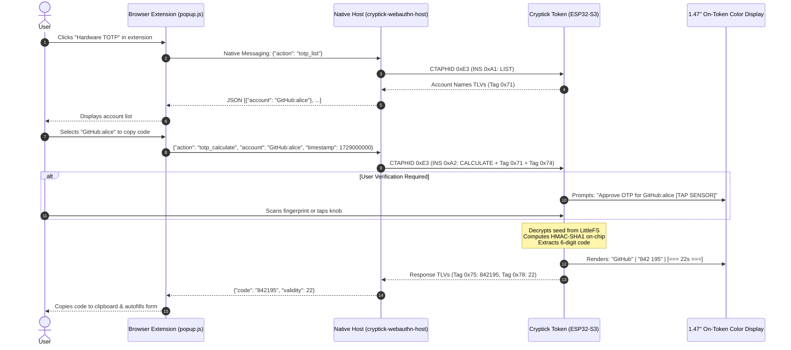

# Hardware OATH-TOTP Specification & Zero-Trust Architecture

This document specifies the on-device **OATH-TOTP (RFC 6238 / RFC 4226)** subsystem for Cryptick Token. It details the **Zero-Trust Passer** architecture, the vendor CTAPHID wire protocol (`0xE3`), data serialization, and biometric gating.

---

## 1. Zero-Trust Passer Architecture

Traditional software authenticators (like Google Authenticator, Authy, or browser extensions) store unencrypted or password-encrypted secret seeds directly in host memory or cloud backups. If the host operating system is compromised by malware, info-stealers, or memory scrapers, all TOTP seeds are permanently lost.

Cryptick introduces the **Zero-Trust Passer Model**:



### The Three Guarantees
1. **Seeds Never Leave Hardware Flash**: Secret seeds are written once during enrollment (`INS 0x01`). Once stored in encrypted LittleFS, there is **no firmware API to read back or export the seed**.
2. **Host Never Computes HMAC**: The host never performs RFC 6238 step calculations. The host simply passes the current Unix timestamp counter.
3. **Biometric Authorization Gate**: Sensitive TOTP credentials can enforce User Verification (UV). The token refuses to return the code unless the enrolled user verifies their physical presence on the hardware sensor.

---

## 2. CTAPHID Vendor Framing (`CTAPHID_CRYPTICK_OATH = 0xE3`)

Cryptick transports OATH commands over CTAPHID using vendor-specific command code `0xE3`:

```text
CTAPHID_CMD = TYPE_INIT | 0x63 = 0x80 | 0x63 = 0xE3
```

### 2.1 Request Structure (Host -> Token)
The payload carried inside CTAPHID frames follows an APDU-lite structure:

| Field | Length | Description |
|---|---|---|
| `CLA` | 1 byte | Class byte: always `0x00`. |
| `INS` | 1 byte | Instruction code (`0xA1`, `0xA2`, `0x01`, `0x03`, `0x04`). |
| `P1`  | 1 byte | Parameter 1: always `0x00`. |
| `P2`  | 1 byte | Parameter 2: always `0x00`. |
| `Lc`  | 1 byte | Length of following data payload (0–255 bytes). |
| `Data`| `Lc` bytes | TLV encoded parameters. |

### 2.2 Response Structure (Token -> Host)
The response contains optional TLV fields followed by a 2-byte ISO 7816 Status Word:

```text
[ Response TLVs (0..N bytes) ] || SW1 (1 byte) || SW2 (1 byte)
```

Common Status Words:
- `0x90 0x00`: **Success**.
- `0x69 0x82`: **Security Status Not Satisfied** (Biometric touch / fingerprint required).
- `0x6A 0x80`: **Incorrect Parameters** (Malformed TLVs or invalid length).
- `0x6A 0x88`: **Referenced Data Not Found** (Account label does not exist).
- `0x6F 0x00`: **Internal Hardware Execution Error**.

---

## 3. Instruction Definitions

### 3.1 `INS 0xA1` — LIST ACCOUNTS
Queries all configured TOTP account labels stored in flash.

- **Request**: `00 A1 00 00 00` (Empty data).
- **Response Payload**: Concatenated Tag `0x71` TLVs for every enrolled account:
  ```text
  [0x71] [Len] [Account String UTF-8] ... [90 00]
  ```
- **Example**:
  `71 0E 47 69 74 48 75 62 3A 61 6C 69 63 65 90 00` ("GitHub:alice")

---

### 3.2 `INS 0xA2` — CALCULATE CODE
Calculates the current OTP code for a specified account label.

- **Request Payload**:
  - `Tag 0x71` (`TAG_NAME`): Account label UTF-8.
  - `Tag 0x74` (`TAG_CHALLENGE`): 8-byte big-endian integer representing the current time-step counter:
    $$\text{counter} = \lfloor \frac{\text{now\_utc\_seconds}}{30} \rfloor$$
- **Request Example**:
  ```text
  00 A2 00 00 1A 71 0C 47 69 74 48 75 62 3A 61 6C 69 63 65 74 08 00 00 00 00 03 89 D4 B0
  ```
- **Response Payload**:
  - `Tag 0x75` (`TAG_RESPONSE`): 4-byte big-endian integer representing the full 6-digit decimal code.
  - `Tag 0x78` (`TAG_PROPERTY`): 1-byte integer indicating the remaining validity seconds in the current 30-second window.
- **Response Example**:
  ```text
  75 04 00 0C DB E7 78 01 16 90 00
  ```
  *(Code value: `0x000CDBE7` = `842727`, remaining: 22 seconds, SW: `90 00`)*

---

### 3.3 `INS 0x01` — ENROLL ACCOUNT (PUT)
Enrolls a new TOTP secret seed onto the hardware token.

- **Request Payload**:
  - `Tag 0x71` (`TAG_NAME`): Account name string (e.g. `AWS:prod-admin`).
  - `Tag 0x73` (`TAG_KEY`): Algorithm identifier byte + raw binary secret seed:
    - Algorithm byte `0x11`: HMAC-SHA1, 6 digits, 30s period.
    - Algorithm byte `0x21`: HMAC-SHA256, 6 digits, 30s period.
  - `Tag 0x78` (`TAG_PROPERTY`): Flags:
    - Bit 0 (`0x01`): Require User Verification (biometric / touch) to calculate.
- **Token Processing**:
  - Encrypts seed under token master key using hardware AES-256-GCM.
  - Writes record to `/oath/<sha256_hash>.bin` in LittleFS.
  - Answers `0x90 0x00`.

---

### 3.4 `INS 0x03` — DELETE ACCOUNT
Permanently deletes an account seed from flash.

- **Request Payload**:
  - `Tag 0x71` (`TAG_NAME`): Account label to delete.
- **Token Processing**:
  - Erases flash sector and zeroes key material.
  - Answers `0x90 0x00`.

---

### 3.5 `INS 0x04` — SET TIME
Synchronizes the token's internal hardware Real-Time Clock (RTC) with host UTC time.

- **Request Payload**:
  - `Tag 0x74` (`TAG_CHALLENGE`): 8-byte big-endian UTC timestamp (seconds since Unix epoch).
- **Response**: `90 00`.

---

## 4. TLV Tag Dictionary

| Tag Value | Tag Constant | Length | Description |
|---|---|---|---|
| `0x71` | `TAG_NAME` | 1–64 bytes | UTF-8 account identifier (e.g. `Issuer:account@domain`). |
| `0x73` | `TAG_KEY` | 11–65 bytes | Algorithm byte (`0x11` / `0x21`) followed by 10–64 byte secret seed. |
| `0x74` | `TAG_CHALLENGE` | 8 bytes | Big-endian 64-bit integer (time-step counter or epoch seconds). |
| `0x75` | `TAG_RESPONSE` | 4 bytes | Big-endian 32-bit integer representing the calculated OTP code. |
| `0x76` | `TAG_TRUNCATED` | 4 bytes | Truncated decimal OTP format. |
| `0x78` | `TAG_PROPERTY` | 1 byte | Account property flags (Bit 0: Touch Required) or remaining seconds. |

---

## 5. Security & Cryptographic Boundary

### LittleFS Storage Encryption
Seeds are saved in LittleFS at `/oath/<id>.bin`. The on-disk structure is:

$$\text{Ciphertext} = \text{AES-256-GCM}_{K_{\text{oath}}}(\text{IV}, \text{Seed}, \text{AAD}=\text{AccountName})$$

Where:
- $K_{\text{oath}} = \text{HKDF-SHA256}(\text{MasterSecret}, \text{"cryptick-oath-storage-v1"})$.
- $\text{IV}$ is a unique 12-byte nonce generated by the hardware TRNG.
- Flash dump attacks yield only encrypted ciphertext; without the hardware eFuse master key, secrets cannot be recovered.
